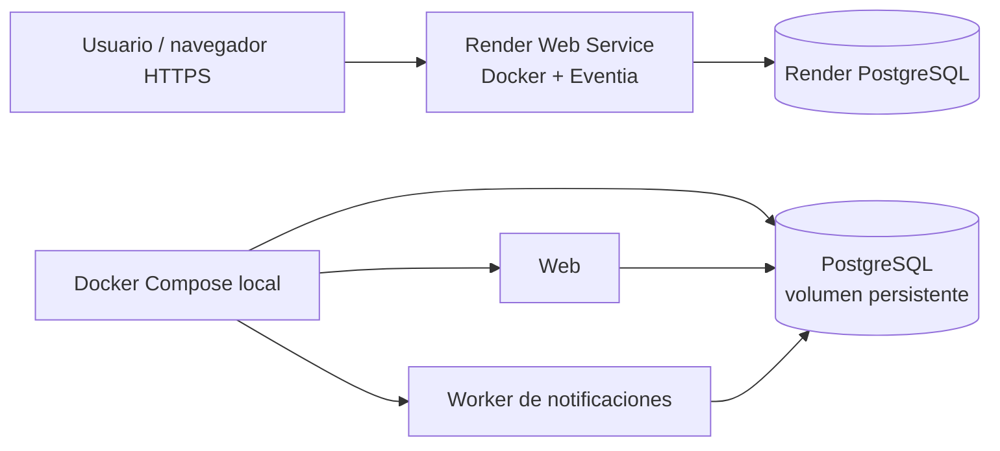

# Actividad 27 — Despliegue web y Docker

## Estado de entregables

| Entregable | Estado | Evidencia / acción |
|---|---|---|
| Aplicación publicada por HTTPS | Pendiente de desplegar | `render.yaml` preparado. GitHub CLI no tiene una sesión válida para `InAlexa`; Render requiere conectar ese repositorio y autorizar la creación de recursos. URL pública: se añade después del primer despliegue exitoso. |
| Persistencia en base de datos remota | Configurada en Blueprint, no ejecutada | Render PostgreSQL asociado al servicio `eventia`; confirmar después del despliegue creando un evento/inscripción, reiniciando el servicio y consultando el registro. |
| Dockerfile / Compose | Preparados | `Dockerfile` ejecuta seed idempotente y escucha `0.0.0.0:$PORT`; `compose.yaml` ejecuta web, PostgreSQL con volumen nombrado y worker. |
| Contenedor ejecutado y capturas | Pendiente de Docker Desktop | El cliente Docker existe, pero el motor no está activo (`dockerDesktopLinuxEngine` no disponible). No se afirma haber construido ni iniciado contenedores. |
| Diagrama de arquitectura | Incluido abajo | Render web (Docker) → Render PostgreSQL. En local: web + PostgreSQL con volumen + worker mediante Compose. |
| Respuestas del análisis técnico | Preparadas abajo | Las preguntas que dependen de ejecución se marcan como pendientes. |
| Repositorio GitHub | Existe | `https://github.com/InAlexa/Eventia`; el token local de GitHub está inválido, así que no se pudo autorizar despliegue desde GitHub ni subir cambios. |

## Plataforma seleccionada

**Render** es la propuesta para el despliegue porque su Blueprint puede crear el servicio Docker y PostgreSQL y enlazar sus variables de entorno. El servicio recibe una URL HTTPS pública; `EVENTIA_ORIGIN` se conecta a `RENDER_EXTERNAL_URL`, `COOKIE_SECURE=1` activa cookies seguras y el servidor escucha el puerto asignado por `PORT`. El endpoint `/healthz` permite comprobar que el servidor está listo.

Para completar: autenticar GitHub, subir estos cambios a `InAlexa/Eventia`, crear un Blueprint en Render a partir del repositorio, revisar los recursos/costos antes de confirmar y esperar el estado Live. Después anotar la URL asignada y probar registro, inicio de sesión, creación de evento, inscripción y persistencia tras reiniciar el servicio.

**Límite del plan gratuito:** Render indica que las bases PostgreSQL gratuitas expiran 30 días después de su creación y tienen límite de almacenamiento; no deben usarse como almacenamiento permanente. Para conservar los datos a largo plazo se debe escoger un plan PostgreSQL que no expire y revisar su precio antes de crear el recurso. [Límites de Render Free](https://render.com/docs/free).

## Arquitectura



## Docker local

Requisito: Docker Desktop iniciado. Desde PowerShell, en la raíz del repositorio:

```powershell
$env:POSTGRES_PASSWORD = 'elige-un-secreto-local'
docker compose up --build -d
docker compose ps
docker compose logs --tail 50 web db
Invoke-WebRequest http://127.0.0.1:8000/healthz
```

`compose.yaml` mantiene PostgreSQL en el volumen Docker `postgres`. Para demostrar persistencia, registra un dato desde Eventia; reinicia con `docker compose restart web` y vuelve a consultar el evento/inscripción. Para detener la aplicación conservando el volumen usa `docker compose down` (no agregues `-v`). Para una ejecución limpia, anota la salida y toma capturas de `docker compose ps`, `/healthz` y el dato antes/después del reinicio.

## Análisis técnico

1. **¿Qué plataforma y por qué?** Render; se eligió por el despliegue del Dockerfile y el Blueprint con PostgreSQL y URL HTTPS. La selección está preparada, no desplegada todavía.
2. **¿Qué componentes se desplegaron y dónde?** Pendiente: blueprint define Eventia en un servicio web Docker y PostgreSQL administrado en Render. Completar con el estado real después de publicar.
3. **¿Qué dificultades hubo?** Pendiente de ejecución. El repositorio no tiene una sesión válida de GitHub CLI y el motor local de Docker no estaba activo al preparar la entrega.
4. **¿Qué ventajas ofrece Docker?** Empaqueta la versión de Python, dependencias y arranque para repetir el mismo entorno; Compose agrega PostgreSQL persistente y el worker con configuración declarativa.
5. **¿Qué mejorar antes de producción?** Usar base de datos con backups y plan que no expire, servidor WSGI/ASGI de producción, pruebas con PostgreSQL y Docker, observabilidad, límites de tráfico/proxy, recuperación de cuenta, paginación administrativa y revisión de seguridad. No se han demostrado carga, alta disponibilidad ni envío SMTP.

## Evidencias pendientes de adjuntar

- URL HTTPS pública y pantallas de Render con el servicio Live.
- Registro de un usuario/evento y consulta del mismo dato después de reinicio.
- `docker compose ps`, logs de arranque, respuesta HTTP `/healthz` y capturas del contenedor.
- Captura o registro que muestre el volumen PostgreSQL conservando los datos.
- Enlace al commit del repositorio que se desplegó.
