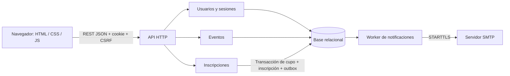

# Arquitectura de Eventia

## Alcance y trazabilidad

Los PDF son material de referencia y requisitos funcionales; sus instrucciones de consultar sitios ajenos, enviar entregables o publicar un repositorio no se ejecutaron como autorizaciones independientes. La petición del usuario fue construir Eventia a partir de ellos. No se modificaron los PDF originales ni se atribuyó el código a los autores citados en sus portadas.

| Fuente | Requisito aplicado | Implementación |
| --- | --- | --- |
| Diseñar hoy, escalar mañana | MVP gratuito, registro, catálogo, gestión, inscripción e historial | Interfaz y API en siete módulos/archivos |
| Diseñar hoy, escalar mañana | Monolito modular y persistencia relacional | Presentación HTML/JS, API HTTP, servicios y repositorios |
| Diseñar hoy, escalar mañana PARTE B | Evolución gradual y separación de tareas secundarias | Outbox durable y worker; plan de extracción posterior |
| Seguridad en aplicaciones web | Propiedad, SQL parametrizado, XSS, cookies y concurrencia | Validación en servidor, DTO, escape de salida, CSP y transacciones |
| Actividad 23 P Web | Siete API auditadas y corregidas, permisos, OpenAPI, evidencia | Service/Server, ACTIVIDAD-23.md, openapi.json, 28 pruebas |

## Componentes

`server.py` controla transporte, cookie, CSRF y respuesta HTTP. `security.py` gestiona hash, validación y límites de frecuencia. `service.py` contiene operaciones de negocio y autorización. `db.py` encapsula conexión y transacciones de SQLite/PostgreSQL. `notifications.py` despacha la outbox. `public/` consume la API sin almacenamiento local de tokens. `manage.py` permite iniciar el servidor y crear cuentas privilegiadas mediante acceso local al sistema.

## Datos y consistencia

Tablas: usuarios, eventos, inscripciones, sesiones, limites y notificaciones. Claves foráneas activas y restricciones de cupo, roles y precio. La clave única `(evento_id,usuario_id)` respalda la regla de una plaza por persona.

La inscripción valida cantidad 1, limita la frecuencia y comienza una transacción. En PostgreSQL bloquea la fila del evento con `FOR UPDATE`; en SQLite reserva el bloqueo de escritura con `BEGIN IMMEDIATE`. Comprueba estado, fecha, duplicados y disponibilidad dentro de ese bloqueo, descuenta un cupo, crea inscripción y agrega una notificación. Cualquier error revierte las tres escrituras. La edición usa el mismo bloqueo para impedir reducir el aforo por debajo de las inscripciones confirmadas. El precio se fija en cero.

SQLite ofrece una ejecución inicial sin instalar un servidor. Su bloqueo de escritor serializa todas las escrituras y limita la concurrencia; no es la estrategia de escala. El adaptador PostgreSQL conserva la API de repositorio con parámetros, transacciones y bloqueo por fila; requiere instalar psycopg y configurar DATABASE_URL. Las pruebas en esta entrega se ejecutaron con SQLite, no con PostgreSQL.

## Autenticación y autorización

Se eligieron sesiones opacas en servidor, una alternativa permitida por la arquitectura original. Tokens aleatorios de 256 bits, expiración de 8 horas, cookie HttpOnly/SameSite=Strict, Secure con HTTPS. La sesión se elimina al cerrar sesión y se revoca al cambiar rol. El rol se vuelve a consultar desde la base en cada petición. CSRF usa un token independiente retornado por login y `/api/auth/me`; las mutaciones autenticadas lo exigen mediante `X-CSRF-Token`. Se validan Origin cuando está presente y Sec-Fetch-Site. Las rutas de login/registro requieren JSON y rechazan orígenes ajenos. No se habilita CORS.

Contraseñas PBKDF2-HMAC-SHA256 con salt aleatorio de 128 bits y 600000 iteraciones; nunca se retornan hashes. Igual mensaje para correo inexistente y contraseña incorrecta; se calcula un hash ficticio para cuentas ausentes. El registro permite exclusivamente nombre/correo/password y asigna usuario. La creación de organizadores o administradores exige una cuenta administrativa o la CLI local.

Cuotas: login 8 intentos/cuenta y 30/IP cada 15 minutos; registro 20/IP por hora; inscripciones 20/usuario por minuto. Los contadores se actualizan atómicamente en base de datos, compartidos entre procesos. Una cuenta puede sufrir bloqueo temporal por abuso de su correo; para producción agregar retos adaptativos y recuperación sin enumeración. El registro devuelve un conflicto genérico para correo duplicado; no se garantiza ocultar la existencia de cuentas en ese flujo.

## Evolución propuesta, sin atribuir capacidad no medida

1. Medir latencia, bloqueos, errores y volumen; desplegar PostgreSQL y servidor de producción, backups y HTTPS.
2. Escalar la API sin estado local de proceso: sesiones y cuotas ya residen en base compartida. Afinar pool de conexiones y expiración.
3. Añadir caché/CDN al catálogo. La disponibilidad cacheada será orientativa; confirmar siempre en el primario, dentro de la transacción.
4. Cambiar outbox a consumidores coordinados con `SKIP LOCKED`, leases y reintentos con backoff. Añadir métricas de correos pendientes y cola de fallos.
5. Extraer notificaciones y luego inscripciones si la demanda medida lo justifica. Usar idempotencia, autenticación entre servicios, cuotas y autorización por recurso en cada límite.
6. Llevar reportes a réplicas de lectura o vistas agregadas; mantener el primario para cupos y consultas que requieren consistencia inmediata. Agregar admisión/colas en picos, sin prometer orden global FIFO que no se haya implementado.

La mención de 750000 usuarios en la Parte B corresponde a un escenario de evolución, no a una capacidad demostrada por este código. No se ha realizado prueba de carga ni auditoría externa.
